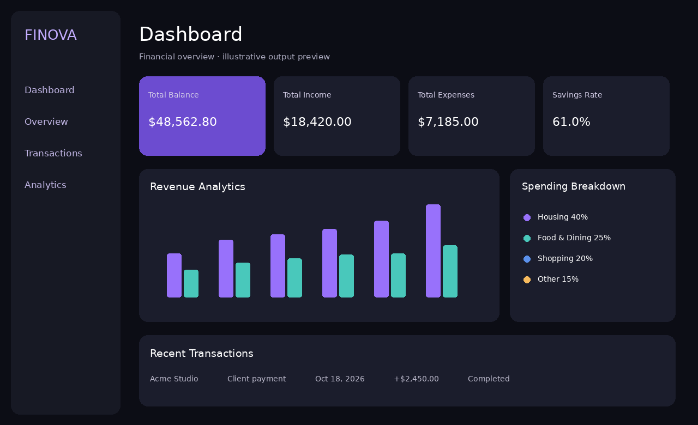

# Finance Dashboard — Frontend Portfolio Project

## About the project
Finance Dashboard is a responsive financial analytics interface for viewing account balances, income, expenses, savings, spending categories, and recent transactions. It demonstrates how financial data can be organized into a clean, accessible, and easy-to-understand web interface.

**Important:** This is a newly created, original demo implementation inspired by the Finance project card in the portfolio screenshot. It is **not a verified copy of the original portfolio project's source code**. All financial information is sample/demo data.

## Features
- Four KPI cards: total balance, income, expenses, and savings rate
- Income vs. expenses chart with selectable 3-, 6-, or 12-month range
- Spending breakdown with a CSS donut chart and category legend
- Searchable recent transactions table
- Responsive desktop/mobile layout
- Semantic HTML, labeled inputs, and descriptive chart text
- No frameworks or external libraries required

## Technologies
- HTML5 — page structure
- CSS3 — layout, responsive design, visualizations
- JavaScript (ES6) — rendering and interactivity

## Folder structure
```
Finance_Dashboard_Project/
├── index.html       # Main dashboard page
├── styles.css       # Dashboard styling and responsive layouts
├── script.js        # Demo data, chart and transaction filtering
├── output.png       # Illustrative output preview of the dashboard layout
└── README.md        # Project documentation
```

## How to run
1. Download and extract the ZIP file.
2. Open `index.html` in Chrome, Edge, or Firefox.
3. Use the **Period** dropdown to change the chart's time range.
4. Use **Search transactions** to filter the table.

No installation, build process, server, or API key is needed.

## Sample data and limitations
The figures are illustrative and stored in `script.js`; the dashboard is not connected to real accounts, authentication, databases, or payment systems. The chart's date-range control changes the displayed chart data only; KPI cards and the spending breakdown remain fixed demo values.

## Possible enhancements
- Integrate a REST API and database
- Add secure sign-in and user accounts
- Support date-filtered KPI calculations
- Add CSV export, sorting, and pagination
- Add automated tests and real-time updates

## Output preview


The included PNG is an **illustrative layout preview**, not a captured browser screenshot. Open `index.html` to see the actual interactive output.

## Submission
Send the ZIP file to the recruiter. It contains all code, documentation, and an illustrative output preview. Describe it as a **frontend finance dashboard demo** unless you can verify that it is the same project as your original portfolio item.
